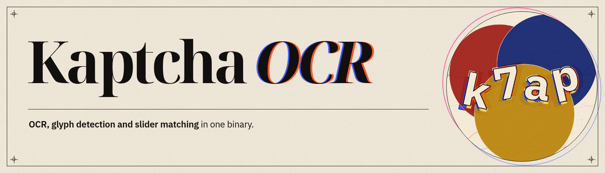
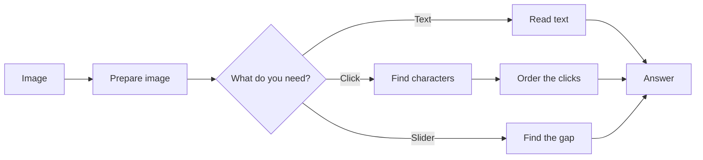

<p align="center">
  
</p>

<p align="center">
  <a href="LICENSE"></a>
  
  
  
  
  <a href="benchmarks/README.md"></a>
</p>

<p align="center">
  <a href="#quick-start">Quick start</a> ·
  <a href="benchmarks/README.md">Benchmarks</a> ·
  <a href="docs/models.md">Models</a> ·
  <a href="docs/api.md">API</a> ·
  <a href="docs/python-client.md">Python client</a> ·
  <a href="docs/README.md">Docs</a>
</p>

**KaptchaOCR** reads text CAPTCHAs, finds the character boxes used by click
CAPTCHAs, and solves slider puzzles. It is a Rust library and a small server in
one binary. You can run it locally, call it over HTTP, or use the Python client.

No Python is needed on the server. The included models work out of the box, and
you can load your own ONNX models with a simple model list.

## Disclaimer

**KaptchaOCR does not solve CAPTCHAs that ask you to pick pictures of cars,
trucks, buses, traffic lights, or other objects.** That is a different job and
is still work in progress. It is not included in this repo yet.

## Features

| What | Details |
| --- | --- |
| Text OCR | Reads letters and numbers. You can limit which characters it looks for. |
| Click CAPTCHAs | Finds the character boxes and puts the clicks in the prompt order. |
| Slider puzzles | Finds the gap and can make a drag path. |
| Server | One binary with an HTTP API, API docs, MCP for AI agents, API keys and rate limits. |
| Models | Included models, plus a model list for your own ONNX files. |
| Python client | Small client with no extra dependencies. |

## Benchmarks

We tested the models on **4,399 CAPTCHA images they had not seen before**, and on
**400 generated images** for character detection.

| | ddddocr | PP-OCRv6 base | KaptchaOCR fine-tuned |
| --- | ---: | ---: | ---: |
| Gets the whole string right | 14–15% | 8.9–28.6% | **67.0–90.7%** |
| Character boxes found correctly | 57.5% | 12.2–32.0%* | **95.7–95.8%** |
| Quick pick | — | tiny: 8.9% at 10 ms | **ft-tiny: 67.0% at 10 ms** |

<sub>Note: PP-OCRv6 detectors put one box around a whole line, not one box per character, so they score low here.</sub>

<p align="center">
  
</p>

<p align="center">
  
</p>

[Full results, tables, charts and method →](benchmarks/README.md)

## Datasets

The synthetic detection set — 20,000 training images plus the 400-image
benchmark split — is public on Hugging Face:
[`zaltahir/kaptchaocr-det`](https://huggingface.co/datasets/zaltahir/kaptchaocr-det).

The recognition set — 169,311 training images, 5,000 validation images and the
six codenamed benchmark splits — is also public:
[`zaltahir/kaptchaocr-rec`](https://huggingface.co/datasets/zaltahir/kaptchaocr-rec).

## Quick start

### Docker

The image builds the binary inside Docker, so you only need Docker. The first
build takes about 10 minutes.

```sh
docker build -t kaptchaocr .
docker run --rm -p 8000:8000 kaptchaocr
```

This starts the server at `http://127.0.0.1:8000` with OCR, detection and
sliders on. See [Docker](docs/docker.md) for API keys, mounts and model presets.

### With Rust

```sh
cargo build --release
make run
```

`make run` uses the balanced `ft-small` model. Use `PROFILE=fast` for the
smallest model or `PROFILE=accurate` for the largest. You can also change the
address with `ADDR=0.0.0.0:8000`.

### Prebuilt binary

When the first release is out, download the `*-inline.zip` for your system. It
contains one binary with the fine-tuned models built in.

### Check that it works

```sh
curl http://127.0.0.1:8000/status
```

## Use it

### HTTP

```sh
IMG="$(base64 < captcha.png | tr -d '\n')"
curl -s http://127.0.0.1:8000/solve \
  -H 'Content-Type: application/json' \
  -d "{\"image\":\"$IMG\"}"
```

```json
{"code":200,"msg":"success","data":{"text":"5+?=8","math":{"expression":"5+?=8","result":3.0,"answer":"3"},"model":"ft-small"}}
```

### Python

```sh
pip install -e clients/python   # PyPI package is being prepared
```

```python
from kaptchaocr import Client

client = Client("http://127.0.0.1:8000")
answer = client.solve(open("captcha.png", "rb").read())
print(answer.text, answer.math.answer if answer.math else None)
```

### Rust

```rust
let mut ocr = kaptchaocr::kaptchaocr_classification()?;
let text = ocr.classification(std::fs::read("captcha.png")?)?;
println!("{text}");
```

## Models

| Model | Task | Size | Use | Hugging Face |
| --- | --- | ---: | --- | --- |
| `ft-tiny` | recognition | 4.3 MB | `fast` preset | [tiny-rec](https://huggingface.co/zaltahir/kaptchaocr-tiny-rec) |
| `ft-small` | recognition | 20 MB | `balanced` preset (default) | [small-rec](https://huggingface.co/zaltahir/kaptchaocr-small-rec) |
| `ft-medium` | recognition | 73 MB | `accurate` preset | [medium-rec](https://huggingface.co/zaltahir/kaptchaocr-medium-rec) |
| `ft-small-det` | glyph detection | 9.5 MB | click CAPTCHAs | [small-det](https://huggingface.co/zaltahir/kaptchaocr-small-det) |
| `ft-medium-det` | glyph detection | 59 MB | click CAPTCHAs, tighter boxes | [medium-det](https://huggingface.co/zaltahir/kaptchaocr-medium-det) |

Every model has its own repo in the
[KaptchaOCR collection](https://huggingface.co/collections/zaltahir/kaptchaocr).
The benchmark also compares ddddocr and PP-OCRv6 base models; those weights are
not included in this repo.

```sh
# pick a speed/accuracy preset
kaptchaocr --ocr --manifest model/models.json --profile fast

# click CAPTCHAs: character detector + recognizer
kaptchaocr --ocr --det --manifest model/models.json \
  --det-model ft-small-det --rec-model ft-small
```

The balanced preset is the default. You can add your own ONNX models through
the model list. See [Models](docs/models.md).

## Documentation

| Guide | What is inside |
| --- | --- |
| [HTTP API](docs/api.md) | All routes, request/response shapes, uploads, errors |
| [OCR](docs/ocr.md) | Character ranges, color filters, probability output |
| [Detection](docs/detection.md) | Character boxes for click CAPTCHAs |
| [Slider](docs/slider.md) | Template and gap matching |
| [Solve API](docs/solve.md) | Text/math, slider and click solving |
| [Models](docs/models.md) | Included models, presets, custom ONNX files |
| [MCP](docs/mcp.md) | MCP tools for AI agents |
| [Docker](docs/docker.md) | Image build, mounts, overrides |
| [Building](docs/building.md) | Source builds, feature flags, linking |
| [CLI](docs/cli.md) | Full command-line reference |
| [Python client](docs/python-client.md) | `kaptchaocr.Client` API |
| [Benchmarks](benchmarks/README.md) | Results, charts, method |
| [Troubleshooting](docs/troubleshooting.md) | CUDA, ONNX Runtime and linking issues |

## How it works

You send an image. The server prepares it, runs the right model, and turns the
result into text, character boxes, or click points.



The models are ONNX files. The Rust code handles image preparation, character
decoding and the click/slider logic. The server adds the HTTP routes, API key,
rate limits, queue and MCP.

## Project status

The library and models are ready. The five fine-tuned models are published on
Hugging Face (see the collection above). Release packages are still being
prepared: GitHub downloads, a Docker image and a PyPI client. Until those are
out, build from source or use Docker.

## Contributing

Run `make test` and `make check` before opening a PR. Issues and PRs are
welcome. The code lives in `src/`, with the models and Python client in
`model/` and `clients/`.

## Acknowledgements

- [ddddocr](https://github.com/sml2h3/ddddocr) — the original implementation
  this project is based on, and the stock models used for benchmark
  comparison. MIT licensed; the notice is in
  [`THIRD_PARTY_LICENSES.md`](THIRD_PARTY_LICENSES.md).
- [PaddleOCR / PP-OCRv6](https://github.com/PaddlePaddle/PaddleOCR) — the base
  models used for the fine-tuned models. Apache-2.0.

## License

[Apache-2.0](LICENSE) © KaptchaOCR contributors.
