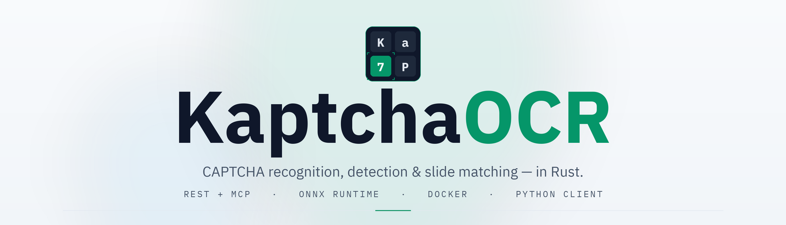
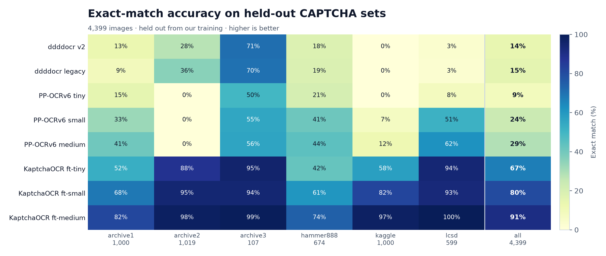
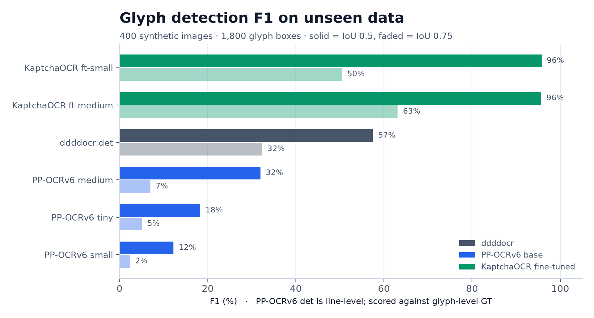
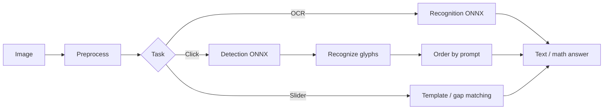

<p align="center">
  <picture>
    <source media="(prefers-color-scheme: dark)" srcset="docs/assets/brand/banner-dark.png">
    
  </picture>
</p>

<p align="center">
  <a href="LICENSE"></a>
  
  
  
  
  <a href="benchmarks/README.md"></a>
</p>

<p align="center">
  <a href="#quick-start">Quick start</a> ·
  <a href="benchmarks/README.md">Benchmarks</a> ·
  <a href="docs/models.md">Models</a> ·
  <a href="docs/api.md">API</a> ·
  <a href="docs/python-client.md">Python client</a> ·
  <a href="docs/README.md">Docs</a>
</p>

**KaptchaOCR** is a Rust library and API server for CAPTCHA recognition:
text OCR, glyph detection for click challenges, and slider matching. It ships
as a single static binary — no OpenCV, no Python runtime on the server side —
and exposes REST, Swagger and MCP from the same process.

Bundled models work out of the box; a manifest lets you swap in any ONNX
recognizer or detector. Fine-tuned tiers take recognition from **14–15% to
90.7%** exact match and glyph detection to **95.8% F1@0.5** on held-out data.

## Features

| Capability | What it does |
| --- | --- |
| **Text OCR** | Charset-constrained CTC decoding; 8 models across 3 size tiers |
| **Glyph detection** | Per-character boxes for click CAPTCHAs, with two fine-tuned detectors |
| **Slider matching** | Template + gap comparison, plus reproducible human-like drag trajectories |
| **Solve endpoints** | `/solve` for text/math, `/solve/click`, `/slide/solve` |
| **Server** | REST + MCP, Swagger UI, API key, rate limiting, concurrency control |
| **Deploy** | Static binary, Docker image, embedded models or a model manifest |

## Benchmarks

Held-out recognition on **4,399 images** (six image-disjoint test sets) and
glyph detection on a fresh **400-image** synthetic split (1,800 boxes).

| | ddddocr | PP-OCRv6 base | KaptchaOCR fine-tuned |
| --- | ---: | ---: | ---: |
| Recognition exact match | 14–15% | 8.9–28.6% | **67.0–90.7%** |
| Detection F1@0.5 | 57.5% | 12.2–32.0%* | **95.7–95.8%** |
| Best speed/accuracy | — | tiny: 8.9% @ 10 ms | **ft-tiny: 67.0% @ 10 ms** |

<sub>Note: PP-OCRv6 detectors are line-level and scored against glyph-level ground truth, so the number is not a drop-in comparison.</sub>

<p align="center">
  <picture>
    <source media="(prefers-color-scheme: dark)" srcset="docs/assets/benchmarks/rec_exact_heatmap_dark.png">
    
  </picture>
</p>

<p align="center">
  <picture>
    <source media="(prefers-color-scheme: dark)" srcset="docs/assets/benchmarks/det_f1_dark.png">
    
  </picture>
</p>

[Full benchmark tables, per-set results, latency charts and methodology →](benchmarks/README.md)

## Quick start

### Docker (recommended)

The image compiles the binary inside its build stage, so the host only needs
Docker — no Rust toolchain. First build takes ~10 minutes; later runs are
instant.

```sh
docker build -t kaptchaocr .
docker run --rm -p 8000:8000 kaptchaocr
```

The container defaults to OCR + detection + slider with the `balanced` profile.
See [Docker](docs/docker.md) for mounts, API keys and tier overrides.

### Native binary

```sh
cargo build --release
make run          # = ./target/release/kaptchaocr --ocr --det --slide \
                  #     --manifest model/models.json --profile balanced
```

```sh
make run PROFILE=accurate    # or fast
make run ADDR=0.0.0.0:8000   # expose on the network
make help
```

### Prebuilt binary

Platform `*-inline.zip` archives (static binary with the stock models embedded)
will be attached to the first GitHub release.

### Verify

```sh
curl http://127.0.0.1:8000/status
```

## Use it

### HTTP

```sh
IMG="$(base64 < captcha.png | tr -d '\n')"
curl -s http://127.0.0.1:8000/solve \
  -H 'Content-Type: application/json' \
  -d "{\"image\":\"$IMG\"}"
```

```json
{"code":200,"msg":"success","data":{"text":"5+?=8","math":{"expression":"5+?=8","result":3.0,"answer":"3"},"model":"ft-small"}}
```

### Python

```sh
pip install -e clients/python   # PyPI package is being prepared
```

```python
from kaptchaocr import Client

client = Client("http://127.0.0.1:8000")
answer = client.solve(open("captcha.png", "rb").read())
print(answer.text, answer.math.answer if answer.math else None)
```

### Rust

```rust
let mut ocr = kaptchaocr::kaptchaocr_classification()?;
let text = ocr.classification(std::fs::read("captcha.png")?)?;
println!("{text}");
```

## Models

| Family | Tasks | Tiers | Size | Role |
| --- | --- | --- | ---: | --- |
| ddddocr (MIT) | rec + det | v2, legacy, stock det | 13–52 MB | Bundled fallback |
| PP-OCRv6 (Apache-2.0) | rec + det | tiny / small / medium | 1.7–73 MB | Base reference models |
| KaptchaOCR fine-tuned | rec + det | tiny / small / medium; det small / medium | 4.3–73 MB | `fast` / `balanced` / `accurate` profiles |

```sh
# pick a tier
kaptchaocr --ocr --manifest model/models.json --profile fast

# click captchas: glyph detector + recognizer
kaptchaocr --ocr --det --manifest model/models.json \
  --det-model ft-small-det --rec-model ft-small
```

Manifest format, custom ONNX import and model licenses: [Models](docs/models.md).

## Documentation

| Guide | Contents |
| --- | --- |
| [HTTP API](docs/api.md) | All routes, request/response shapes, uploads, errors |
| [OCR](docs/ocr.md) | Charsets, color filters, probability output |
| [Detection](docs/detection.md) | Glyph boxes and click-captcha detection |
| [Slider](docs/slider.md) | Template and gap matching |
| [Solve API](docs/solve.md) | Text/math, slider and click solving |
| [Models](docs/models.md) | Models, manifest, profiles, custom import |
| [MCP](docs/mcp.md) | MCP tools and JSON-RPC examples |
| [Docker](docs/docker.md) | Image build, mounts, overrides |
| [Building](docs/building.md) | Source builds, feature flags, linking |
| [CLI](docs/cli.md) | Full flag reference |
| [Python client](docs/python-client.md) | `kaptchaocr.Client` API |
| [Benchmarks](benchmarks/README.md) | Results, charts, methodology |
| [Troubleshooting](docs/troubleshooting.md) | CUDA, ORT and static-linking issues |
| [Developer guide](developer-guide.md) | Architecture and code map |

## How it works



Models are ONNX Runtime sessions; preprocessing, charset decoding and
postprocessing live in the Rust library. The server adds routing, auth, rate
limits, concurrency control and the MCP adapter.

## Project status

The library, models and benchmarks are complete. First public release
packaging — GitHub release binaries, GHCR image, PyPI client, Hugging Face
models — is in progress. Until the first tag, pin a commit for production.

## Contributing

```sh
make test     # 55 library tests, both feature configs
make check    # fmt + clippy, both configs
```

Issues and PRs are welcome. For architecture, test layout and the code map,
read the [developer guide](developer-guide.md).

## Acknowledgements

- [ddddocr](https://github.com/sml2h3/ddddocr) — the bundled stock recognition
  and detection models, and the original implementation this project is based
  on. MIT licensed; the required notice is reproduced in
  [`THIRD_PARTY_LICENSES.md`](THIRD_PARTY_LICENSES.md).
- [PaddleOCR / PP-OCRv6](https://github.com/PaddlePaddle/PaddleOCR) — the base
  detection/recognition models used for the fine-tuned tiers. Apache-2.0.

## License

[Apache-2.0](LICENSE) © KaptchaOCR contributors.
