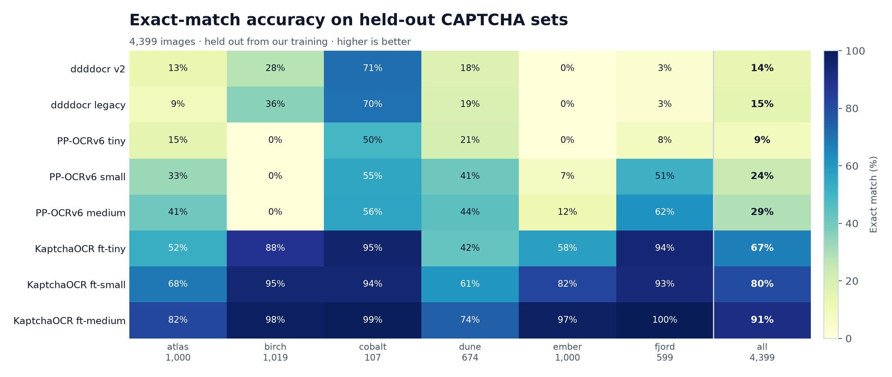
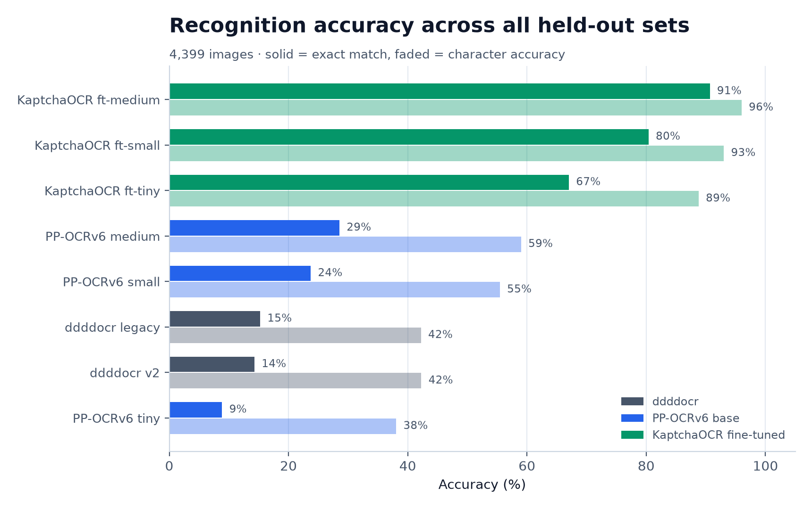
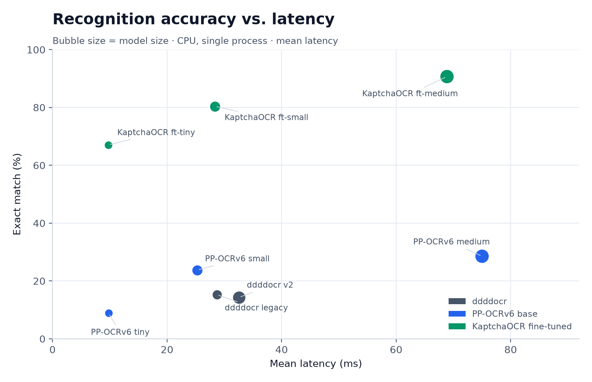
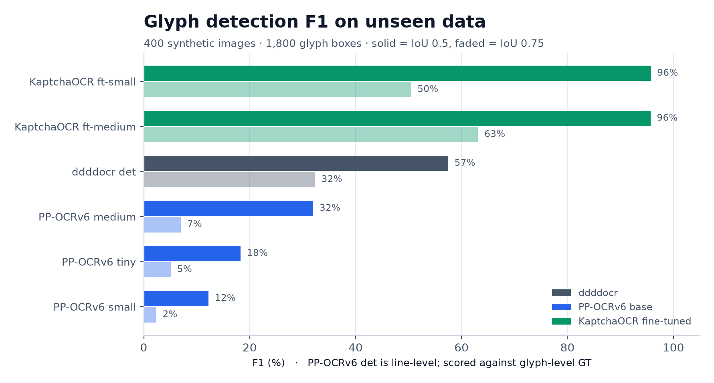
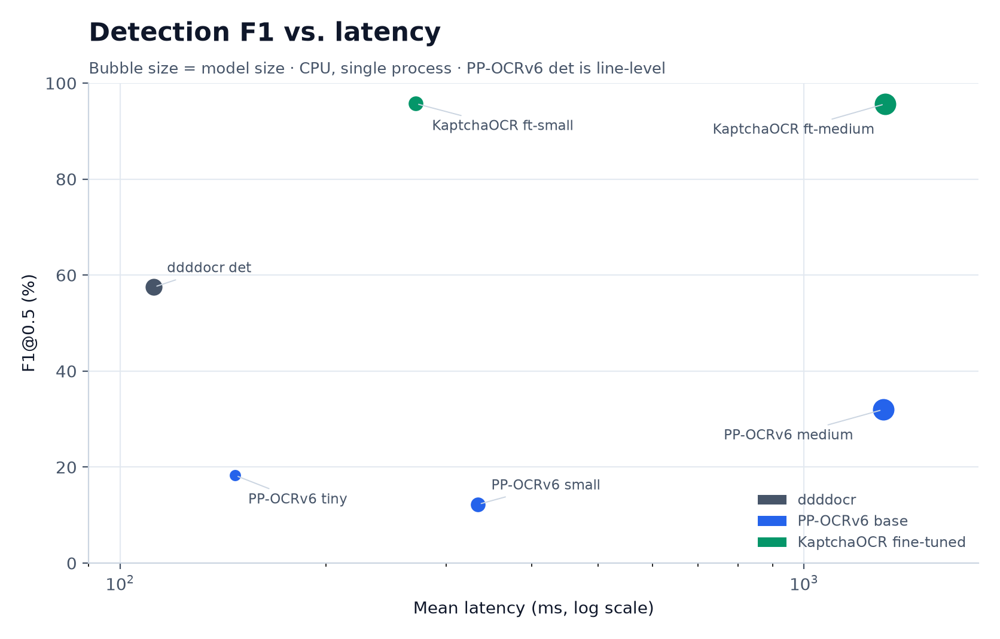

# Benchmarks

Performance of the KaptchaOCR models and comparison baselines on **held-out
CAPTCHA data**. Every number here comes from the raw CSVs in
[`results/`](results/); the charts are regenerated by
[`plot_benchmarks.py`](plot_benchmarks.py).

> These are recognition/detection benchmarks, not a claim of universal
> accuracy. The test images are held out from **our** training, but they come
> from the same public sources as the training data. This is an
> image-disjoint benchmark, not an out-of-distribution benchmark.

## Results at a glance

- **Recognition:** fine-tuning lifts overall exact match from **14–15%**
  (ddddocr stock) and **29%** (best PP-OCRv6 base) to **91%**
  (KaptchaOCR `ft-medium`).
- **Efficiency pick:** `ft-tiny` reaches **67%** exact at **9.8 ms/image** —
  the same latency and size as PP-OCRv6 tiny (8.9%).
- **Detection:** `ft-small-det` reaches **95.8% F1@0.5** at 270 ms;
  `ft-medium-det` matches it at F1@0.5 (95.7%) and is much stronger at the
  tighter IoU 0.75 (63.1% vs 50.5%), but is ~5× slower.
- PP-OCRv6 **recognition** base models collapse case on 10-character sets
  (0% exact on `birch`) while keeping respectable character accuracy;
  fine-tuning fixes exactly that.

## Recognition (OCR)

<picture>
  <source media="(prefers-color-scheme: dark)" srcset="../docs/assets/benchmarks/rec_exact_heatmap_dark.png">
  
</picture>

<picture>
  <source media="(prefers-color-scheme: dark)" srcset="../docs/assets/benchmarks/rec_macro_accuracy_dark.png">
  
</picture>

### Test sets

Six image-disjoint held-out sets, **4,399 images** total. No filename appears
in the 194,355-line training split.

| Split | Images |
| --- | ---: |
| `atlas` | 1,000 |
| `birch` | 1,019 |
| `cobalt` | 107 |
| `dune` | 674 |
| `ember` | 1,000 |
| `fjord` | 599 |

### Models

| Family | Models |
| --- | --- |
| KaptchaOCR fine-tuned (bundled) | tiny, small, medium |
| ddddocr (MIT, comparison only) | `stock-common` (v2), `stock-old` (legacy) |
| PP-OCRv6 base (Apache-2.0, comparison only) | tiny, small, medium |

Only the KaptchaOCR fine-tuned models are bundled. The ddddocr and PP-OCRv6
base weights are comparison baselines and are not redistributed.

Fine-tuned models are PP-OCRv6 recognition models fine-tuned on the training
split, exported to ONNX. The server exposes tiers via manifest profiles:
`fast` → `ft-tiny`, `balanced` → `ft-small`, `accurate` → `ft-medium`.

### Overall accuracy

Sorted by exact match. “Exact” is the whole string, case-sensitive;
“char” is position-aligned character accuracy (not CER).

| Model | Family | Exact | Char | Mean latency | Size |
| --- | --- | ---: | ---: | ---: | ---: |
| **KaptchaOCR ft-medium** | fine-tuned | **90.7%** | **96.0%** | 69 ms | 73 MB |
| **KaptchaOCR ft-small** | fine-tuned | **80.4%** | **93.0%** | 28 ms | 20 MB |
| **KaptchaOCR ft-tiny** | fine-tuned | **67.0%** | **88.8%** | 10 ms | 4.3 MB |
| PP-OCRv6 medium | base | 28.6% | 59.0% | 75 ms | 73 MB |
| PP-OCRv6 small | base | 23.7% | 55.5% | 25 ms | 20 MB |
| ddddocr legacy | stock | 15.3% | 42.2% | 29 ms | 13 MB |
| ddddocr v2 | stock | 14.3% | 42.3% | 33 ms | 52 MB |
| PP-OCRv6 tiny | base | 8.9% | 38.1% | 10 ms | 4.3 MB |

<details>
<summary>Per-set exact match</summary>

| Model | atlas | birch | cobalt | dune | ember | fjord |
| --- | ---: | ---: | ---: | ---: | ---: | ---: |
| ddddocr v2 | 13% | 28% | 71% | 18% | 0% | 3% |
| ddddocr legacy | 9% | 36% | 70% | 19% | 0% | 3% |
| PP-OCRv6 tiny | 15% | 0% | 50% | 21% | 0% | 8% |
| PP-OCRv6 small | 33% | 0% | 55% | 41% | 7% | 51% |
| PP-OCRv6 medium | 41% | 0% | 56% | 44% | 12% | 62% |
| KaptchaOCR ft-tiny | 52% | 88% | 95% | 42% | 58% | 94% |
| KaptchaOCR ft-small | 68% | 95% | 94% | 61% | 82% | 93% |
| KaptchaOCR ft-medium | 82% | 98% | 99% | 74% | 97% | 100% |

</details>

### Accuracy vs. latency

<picture>
  <source media="(prefers-color-scheme: dark)" srcset="../docs/assets/benchmarks/rec_accuracy_latency_dark.png">
  
</picture>

## Detection

<picture>
  <source media="(prefers-color-scheme: dark)" srcset="../docs/assets/benchmarks/det_f1_dark.png">
  
</picture>

<picture>
  <source media="(prefers-color-scheme: dark)" srcset="../docs/assets/benchmarks/det_accuracy_latency_dark.png">
  
</picture>

### Test set

A fresh synthetic set generated after model selection:

- 400 images, 1,800 glyph boxes
- scatter layout, English + Chinese characters
- seed `20261103`, never used for training or checkpoint selection
- source: `gen_det` in the training workspace

Earlier `val`/`val2` splits were used while selecting checkpoints, so they are
not used for the headline numbers. Real click-captcha detection data is not
available yet; this is a synthetic proxy.

### Models and results

Sorted by F1@0.5. Glyph-level ground truth; greedy polygon matching.

| Model | Family | F1@0.5 | F1@0.75 | P@0.5 | R@0.5 | mIoU | Mean latency | Size |
| --- | --- | ---: | ---: | ---: | ---: | ---: | ---: | ---: |
| **KaptchaOCR ft-small** | fine-tuned | **95.8%** | 50.5% | 93.9% | 97.7% | 0.750 | 270 ms | 9.5 MB |
| **KaptchaOCR ft-medium** | fine-tuned | **95.7%** | **63.1%** | 93.5% | 97.9% | 0.769 | 1,315 ms | 59 MB |
| ddddocr det | stock | 57.5% | 32.4% | 85.3% | 43.3% | 0.755 | 112 ms | 19 MB |
| PP-OCRv6 medium | base | 32.0% | 7.0% | 43.2% | 25.4% | 0.683 | 1,305 ms | 59 MB |
| PP-OCRv6 tiny | base | 18.3% | 5.1% | 22.3% | 15.5% | 0.682 | 147 ms | 1.7 MB |
| PP-OCRv6 small | base | 12.2% | 2.4% | 19.3% | 8.9% | 0.659 | 334 ms | 9.4 MB |

> **Fairness note:** PP-OCRv6 detection models are **line-level** detectors,
> while this task needs per-glyph boxes. They are evaluated against glyph-level
> ground truth and are expected to score low here; they are included as the
> base-model reference, not as drop-in replacements for click captchas.
> Fine-tuned detectors are glyph-level.

## How the numbers were produced

- **Hardware:** Intel Core i5-1145G7 (4C/8T), 16 GB RAM, Linux, CPU inference.
- **Runtime:** ONNX Runtime, single process, ORT default thread count; models
  loaded sequentially; one warm-up image per model.
- **Latency:** mean wall-clock ms per image, including pre-processing. These
  are rough comparisons on one machine, not a throughput guarantee.
- **Recognition:** `eval_dataset` over `labels.txt` splits in the private
  training workspace; exact match is case-sensitive.
- **Detection:** `eval_det` over `images/` + `gt.json`; polygon IoU with greedy
  matching at 0.5 and 0.75.
- **Model sizes** are the ONNX file sizes.

### Reproduce the charts

The raw inference outputs are committed here. Re-running inference needs the
private evaluation harness; the public repo can regenerate every chart from the
committed CSVs:

```sh
python3 -m pip install matplotlib numpy
python3 benchmarks/plot_benchmarks.py
```

No dataset images are redistributed in this repository. The synthetic detection
set is public on Hugging Face:
[`zaltahir/kaptchaocr-det`](https://huggingface.co/datasets/zaltahir/kaptchaocr-det).
The recognition images remain at their original sources because their licenses
are mixed. See [`THIRD_PARTY_LICENSES.md`](../THIRD_PARTY_LICENSES.md) for the
ddddocr (MIT) and PP-OCRv6 (Apache-2.0) notices.

## Files

| Path | Contents |
| --- | --- |
| `results/rec_2026-11-03.csv` | per-split × per-model exact/char/latency |
| `results/det_2026-11-03.csv` | per-model P/R/F1/mIoU/latency |
| `results/rec_summary.csv` | aggregated recognition numbers |
| `results/det_summary.csv` | aggregated detection numbers |
| `plot_benchmarks.py` | regenerates all charts from the CSVs |
| `../docs/assets/benchmarks/` | light/dark PNG charts (the plot script also writes SVG) |
