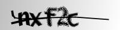
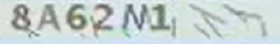

# OCR recognition

The recognizer handles single-line text: alphanumeric CAPTCHAs, mixed case,
Chinese characters, and a range of special characters. The bundled default is
`ft-small`; the other fine-tuned tiers are described in [Models](models.md).

```rust
let image = std::fs::read("captcha.png").unwrap();
let mut ocr = kaptchaocr::kaptchaocr_classification().unwrap();
let text = ocr.classification(image).unwrap();
println!("{text}");
```

Use `--rec-model` or the manifest to pick another tier. To load a custom ONNX
model + charset, see [Models](models.md#custom-models).

## Transparent PNGs

`png_fix` treats a transparent background as white:

```rust
ocr.classification_with_png_fix(image, true);
```

The HTTP API exposes the same flag as `"png_fix": true`.

## Color filters

Preset names: `red`, `blue`, `green`, `yellow`, `orange`, `purple`, `cyan`,
`black`, `white`, `gray`.

```rust
let ocr = kaptchaocr::kaptchaocr_classification().unwrap();
let image = std::fs::read("image/4.png").unwrap();

// Keep only green
let text = ocr
    .classification_with_filter(&image, "green")
    .unwrap();

// Keep red and green
let text = ocr
    .classification_with_filter(&image, ["red", "green"])
    .unwrap();

// HSV ranges: (min_hsv, max_hsv)
let text = ocr
    .classification_with_filter(
        &image,
        [((40, 50, 50), (80, 255, 255))],
    )
    .unwrap();
```

Over HTTP, `color_filter` accepts a name, an array of names, or HSV ranges:

```json
{"image": "base64...", "color_filter": ["red", "green"]}
```

## Charsets

Constrain candidates globally with `set_ranges`, or per call with
`classification_probability_with_ranges` / the `charset_range` request field.

| Value | Candidates |
| --- | --- |
| `0` | digits `0-9` |
| `1` | lowercase `a-z` |
| `2` | uppercase `A-Z` |
| `3` | `a-z` + `A-Z` |
| `4` | `a-z` + `0-9` |
| `5` | `A-Z` + `0-9` |
| `6` | `a-z` + `A-Z` + `0-9` |
| `7` | the default charset minus letters and digits |
| any other string | explicit candidate set, e.g. `"0123456789+-x/="` |

`charset_range` is also supported by the fine-tuned PP-OCRv6 CTC models; this
is what makes the click-captcha solver efficient.

## Probability output

`classification_probability` returns the full per-timestep probability matrix
and the stable charset order. `get_text()` and `get_confidence()` are
convenience accessors.

```rust
let image = std::fs::read("captcha.png").unwrap();
let mut ocr = kaptchaocr::kaptchaocr_classification().unwrap();

ocr.set_ranges("0123456789+-x/=");
let result = ocr.classification_probability(image).unwrap();

println!("text: {}", result.get_text());
println!("confidence: {}", result.get_confidence());
println!("probability: {}", result.json());
```

The probability matrix can be large; prefer it for offline analysis rather than
per-request logging.

## Reference images

<p>
  
  
  
  
</p>

## HTTP

See [`POST /ocr`](api.md#ocr). For a ready answer instead of raw text, use
[`/solve`](solve.md#text-and-math-captchas-post-solve).
