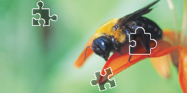

# Slider matching

Slider solving does not use a neural network. The library provides template
matching and difference-based comparison, plus a trajectory generator for
human-like drags.

## Algorithm 1 — separate slider image

The target is a small PNG with a transparent background; the background
contains the matching slot.

```rust
let target = std::fs::read("slider.png").unwrap();
let background = std::fs::read("background.png").unwrap();

let result = kaptchaocr::slide_match(target, background).unwrap();
println!("{:?}", result);
```

If the small image is a plain JPG/BMP without much surrounding background, use
the cheaper `simple_slide_match`:

```rust
let result = kaptchaocr::simple_slide_match(target, background).unwrap();
```

<p>
  
  
</p>

## Algorithm 2 — pit vs. full image

One image is the original page (or a rendering with a pit); the other is the
full page. `slide_comparison` returns the gap position.

```rust
let pit = std::fs::read("pit.png").unwrap();
let full = std::fs::read("full.png").unwrap();

let result = kaptchaocr::slide_comparison(pit, full).unwrap();
println!("{:?}", result);
```

## HTTP

- `POST /slide_match` — `target_image`, `background_image`,
  `simple_target` (bool).
- `POST /slide_comparison` — `target_image`, `background_image`.
- `POST /slide/solve` — match + drag distance/trajectory.

```sh
IMG1="$(base64 < slider.png | tr -d '\n')"
IMG2="$(base64 < background.png | tr -d '\n')"
curl -s http://127.0.0.1:8000/slide_match \
  -H 'Content-Type: application/json' \
  -d "{\"target_image\":\"$IMG1\",\"background_image\":\"$IMG2\",\"simple_target\":true}"
```

See [Solve API](solve.md#slider-captchas-post-slidesolve) for the drag
distance and trajectory fields.
